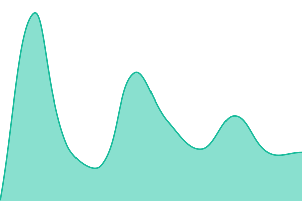

# Packpath status

Uptime monitor and public status page for the Packpath GS1 Digital Link resolver, powered by
[Upptime](https://upptime.js.org). Checks run every 5 minutes from GitHub Actions; results,
response times and incidents are committed to this repository.

Status page: https://himashi.github.io/packpath-status

<!--start: status pages-->
<!-- This summary is generated by Upptime (https://github.com/upptime/upptime) -->
<!-- Do not edit this manually, your changes will be overwritten -->
<!-- prettier-ignore -->
| URL | Status | History | Response Time | Uptime |
| --- | ------ | ------- | ------------- | ------ |
|  [Resolver description file](https://packpath-resolver.star-lab-system.workers.dev/.well-known/gs1resolver) | 🟩 Up | [resolver-description-file.yml](https://github.com/Himashi/packpath-status/commits/HEAD/history/resolver-description-file.yml) | 

 467ms
     
 | 

<a href="https://Himashi.github.io/packpath-status/history/resolver-description-file">100.00%</a>
    

|  [Resolver lookup (linkset)](https://packpath-resolver.star-lab-system.workers.dev/01/09520123456788?linkType=linkset) | 🟩 Up | [resolver-lookup-linkset.yml](https://github.com/Himashi/packpath-status/commits/HEAD/history/resolver-lookup-linkset.yml) | 

 504ms
     
 | 

<a href="https://Himashi.github.io/packpath-status/history/resolver-lookup-linkset">100.00%</a>
    

|  [Resolver redirect (scan)](https://packpath-resolver.star-lab-system.workers.dev/01/09520123456788/10/ABC1?17=271231) | 🟩 Up | [resolver-redirect-scan.yml](https://github.com/Himashi/packpath-status/commits/HEAD/history/resolver-redirect-scan.yml) | 

 742ms
     
 | 

<a href="https://Himashi.github.io/packpath-status/history/resolver-redirect-scan">100.00%</a>
    

<!--end: status pages-->
